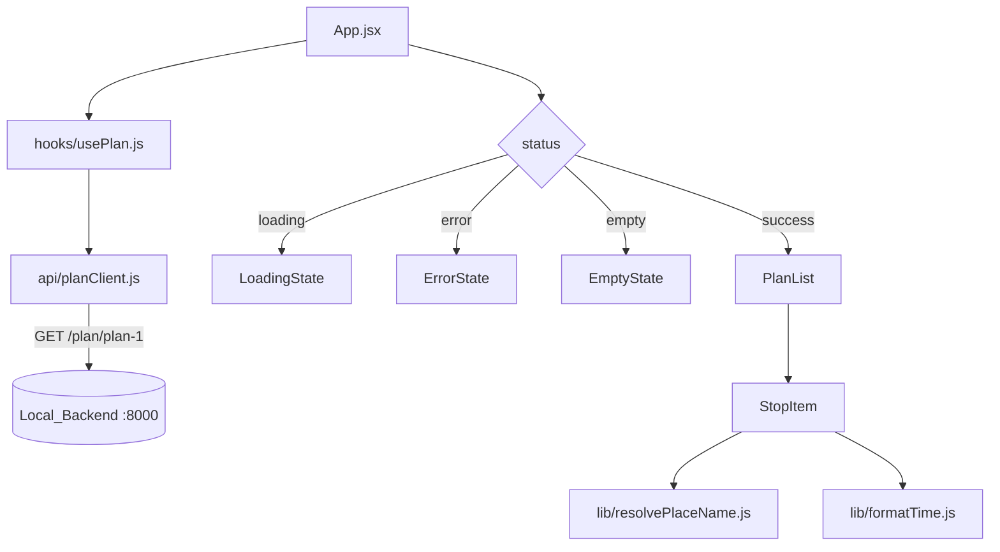

# Design Document

## Overview

`frontend/` 에 React + Vite(JavaScript) 앱을 만들고, 마운트 시 `GET /plan/plan-1` 을 한 번 호출해 `plan.stops` 를 순서대로 목록으로 보여 준다. 화면 상태는 `loading`, `success`, `empty`, `error` 네 가지다.

설계 결정:

| 결정 | 선택 | 이유 |
|---|---|---|
| 상태 관리 | `useReducer` 기반 훅 `usePlan` 하나 | 상태가 네 가지뿐이라 라이브러리가 필요 없다. |
| HTTP | 브라우저 `fetch` + `AbortController` | 의존성을 늘리지 않는다. 시간 초과(10초)와 언마운트 취소를 같은 방식으로 처리한다. |
| 스타일 | 일반 CSS 파일 + CSS 변수, 미디어 쿼리 | 지도 등 후속 기능과 충돌할 외부 UI 라이브러리를 피한다. |
| 라우팅 | 없음 | 화면이 하나다. 필요해지면 후속 작업에서 추가한다. |
| 시각 표시 | `Intl.DateTimeFormat` 에 `timeZone: "Asia/Seoul"` 고정 | 브라우저 시간대와 무관하게 부산 현지 시각을 보여 준다. |
| plan_id | `plan-1` 상수 | 백엔드 뼈대가 이 ID 만 지원한다. 결정 방법은 "팀원 검토 필요 항목" 에 기록한다. |
| 테스트 | Vitest + React Testing Library (+ 선택: fast-check) | Vite 와 설정을 공유한다. 순수 함수는 속성 테스트로 검증한다. |
| UI 문구 | 한국어, `src/constants/messages.js` 한 곳에 모음 | 후속 다국어 전환 때 교체 지점을 하나로 둔다. |

## Architecture



디렉터리 (`frontend/` 기준, 이번 작업에서 만드는 파일):

```
frontend/
  index.html                 # viewport 메타, lang="ko"
  package.json
  vite.config.js             # Vitest 설정 포함
  README.md                  # 실행 방법 (한국어)
  .env.example               # VITE_API_BASE_URL=http://127.0.0.1:8000
  src/
    main.jsx
    App.jsx
    styles/app.css
    constants/messages.js
    api/planClient.js
    hooks/usePlan.js
    lib/resolvePlaceName.js
    lib/formatTime.js
    components/PlanList.jsx
    components/StopItem.jsx
    components/LoadingState.jsx
    components/EmptyState.jsx
    components/ErrorState.jsx
    mocks/                   # backend/app/data/ 의 복사본 (테스트 전용)
      sample_plan.json
      places.json
    __tests__/               # 단위·컴포넌트 테스트
```

`package.json` 의 `dev`, `build` 스크립트는 `vite`, `vite build` 를 그대로 호출하고 종료 코드를 가리거나 소스를 수정하는 래퍼를 두지 않는다 (Requirement 1.4: 실패 시 Vite/npm 의 0이 아닌 종료 코드와 오류 출력이 그대로 나오고 기존 소스는 바뀌지 않는다). 소스 파일은 `.js`/`.jsx` 만 사용한다 (Requirement 1.1). `README.md` 는 "백엔드 서버 시작", "프론트엔드 시작", "환경 변수 `VITE_API_BASE_URL`" 세 섹션을 각각 분리해 한국어로 쓴다 (Requirement 1.8). Base_URL 은 `import.meta.env.VITE_API_BASE_URL` 이 공백 아닌 문자열이면 그 값, 아니면(미설정·빈 문자열) `http://127.0.0.1:8000` 이다 (Requirement 1.5, 1.6).

데이터 흐름: `App` 이 `usePlan()` 을 호출한다. 훅은 `fetchPlan` 을 호출하고 결과를 상태로 바꾼다. `success` 에서 `plan.stops.length === 0` 이면 `empty` 로 분기한다. `PlanList` 는 `places` 를 `Map(place_id → Place)` 로 한 번 만들어 각 `StopItem` 에 해당 Place 를 넘긴다.

## Components and Interfaces

### api/planClient.js

```js
// 성공 시 { plan, places } 를 반환하고, 실패 시 PlanClientError 를 던진다.
export async function fetchPlan(planId, { baseUrl, signal, timeoutMs = 10000 })

export class PlanClientError extends Error {
  // kind: "network" | "timeout" | "http" | "invalid_response"
  // status: HTTP 상태 코드 (kind === "http" 일 때만), code/serverMessage: Error_Body 값 (있을 때만)
  kind; status; code; serverMessage;
}
```

동작:

1. URL 은 `${baseUrl}/plan/${encodeURIComponent(planId)}` 로 만든다. `baseUrl` 끝의 `/` 는 제거한다.
2. 호출자의 `signal` 과 내부 타임아웃 `AbortController` 를 합쳐 `fetch` 에 넘긴다.
3. `fetch` 가 예외를 던지면, 타임아웃으로 중단됐을 때 `timeout`, 호출자 취소는 그대로 다시 던지고(훅이 무시), 그 외는 `network` 로 변환한다.
4. `response.status !== 200` 이면(4xx/5xx 외에 201, 204 등 다른 상태 포함) 본문을 JSON 으로 읽어 보고 `error` 가 객체이고 `error.code`, `error.message` 가 모두 문자열이면 `http` 오류에 담는다. 읽기 실패나 형식 불일치여도 `http` 오류(상태 코드만)로 던진다 (Requirement 2.6, 8.4).
5. 상태가 200 이면 JSON 을 읽고(JSON 이 아니면 `invalid_response`) `Array.isArray(body.plan?.stops)` 와 `Array.isArray(body.places)` 를 검사한다. 하나라도 실패하면 `invalid_response` 를 던진다.

### hooks/usePlan.js

```js
// 반환: { state, retry }
// state: { status: "loading" } | { status: "success", plan, places }
//      | { status: "empty", plan } | { status: "error", error: PlanClientError }
export function usePlan(planId = "plan-1")
```

- 마운트 시 1회 요청. `retry()` 는 상태를 `loading` 으로 되돌리고 같은 요청(`GET {Base_URL}/plan/plan-1`)을 1회 다시 보낸다. 상태가 `loading` 이면 `retry()` 는 아무것도 하지 않아 동시 요청이 1건을 넘지 않는다. 로딩 중에는 `ErrorState` 가 화면에 없으므로 "다시 시도" 버튼도 보이지 않는다 (Requirement 6.5, 8.6, 8.7).
- 새 응답이 `empty` 또는 `success` 로 이어지면 이전 상태 화면은 상태 전환만으로 교체된다 (예: `empty` 에서 재요청 후 항목이 있으면 빈 상태 문구 제거, Requirement 7.5).
- 언마운트 또는 재요청 시 이전 요청을 `abort` 해서 늦게 도착한 응답이 상태를 덮어쓰지 않게 한다. 호출자 취소로 인한 `AbortError` 는 상태에 반영하지 않는다.
- React StrictMode 의 개발 모드 이중 마운트에서도 최종 상태는 같다. 첫 요청은 cleanup 으로 취소된다.
- 오류 시 `console.error("[일정] 요청 실패: 종류=%s HTTP 상태=%s", kind, status ?? "없음")` 형태의 한국어 로그를 오류당 1건 남긴다. 인증 정보와 환경 변수 값은 넣지 않는다 (Requirement 8.10).

### lib/resolvePlaceName.js

```js
const SUPPORTED = ["en", "ja", "zh-Hans", "zh-Hant"];

// 반환: { name: string, isFallbackToId: boolean }
export function resolvePlaceName(stop, placesById, language)
```

결정 순서 (Requirement 4):

1. `lang = SUPPORTED.includes(language) ? language : "en"` (대소문자 구분. `null`, `undefined`, 빈 문자열도 `en`)
2. `place = placesById.get(stop.place_id)`. 없으면 `{ name: stop.place_id, isFallbackToId: true }`.
3. 다음 후보 중 비어 있지 않은 문자열(공백만 있는 값 제외)을 먼저 찾는다: `names[lang]`, `names.en`, `Object.values(names)` 의 첫 비어 있지 않은 값.
4. 후보가 없으면 `{ name: place_id, isFallbackToId: true }`.

`names` 가 객체가 아니거나 없어도 예외 없이 4번으로 간다. 입력 객체를 변경하지 않는다.

### lib/formatTime.js

```js
// ISO 8601 문자열 → "HH:mm" (Asia/Seoul). 해석할 수 없으면 "--:--".
export function formatTime(iso)
```

문자열이 아니거나 비어 있거나 누락되었거나, ISO 8601 날짜·시각 형태(`YYYY-MM-DDTHH:mm` 로 시작하고 `Z` 또는 `±HH:mm` 오프셋이 선택적으로 붙는 형태)가 아니거나, `Date.parse` 가 `NaN` 이면 `--:--` 를 반환한다. `Date.parse` 는 ISO 가 아닌 문자열(`"Nov 5"` 등)도 받아들이므로 형태 검사를 먼저 한다. 오프셋이 없는 값은 `Date.parse` 의 해석(로컬 시간)을 따르되 이번 작업에서는 계약상 오프셋이 항상 있다고 가정한다 (R8). `StopItem` 이 시각 범위를 `{start} – {end}` (공백, en dash, 공백)로 조합하므로 한쪽만 `--:--` 여도 다른 쪽과 나머지 항목은 정상 표시된다 (Requirement 5.2, 5.5). `Intl.DateTimeFormat("en-GB", { hour: "2-digit", minute: "2-digit", hour12: false, timeZone: "Asia/Seoul" })` 를 모듈 수준에서 한 번 만들어 쓴다. 자정은 `00:00` 으로 나오는지 구현 시 확인한다 (일부 환경의 `24:00` 방지).

### components

| 컴포넌트 | props | 책임 |
|---|---|---|
| `PlanList` | `plan`, `places` | 날짜(`plan.date` 를 변환 없이 그대로), `placesById` 생성, `<ol>` 로 `StopItem` 나열 |
| `StopItem` | `stop`, `place`(없을 수 있음), `language` | 시각 범위, 장소명, 고정 배지, 이름 대체 보조 문구 |
| `LoadingState` | 없음 | `role="status"`, `aria-busy="true"`, "일정을 불러오는 중" 문구, 스피너(CSS). 로딩이 끝나면 컴포넌트가 사라져 문구와 `aria-busy` 가 함께 제거된다. |
| `EmptyState` | `date`(없을 수 있음) | "아직 일정이 없습니다" 문구 1회. `date` 가 없거나 빈 문자열이면 날짜 영역을 렌더링하지 않는다. |

`placesById` 는 `places` 를 앞에서부터 순회하며 `place_id` 가 아직 없을 때만 `set` 한다. 같은 `place_id` 가 중복되면 가장 먼저 나온 Place 가 쓰인다 (Requirement 4.9). 목록의 React `key` 는 `stop_id` 이고, `stop_id` 가 중복된 원소는 `stop_id` 뒤에 등장 순번을 붙여(`s1`, `s1#2`, ...) 고유하게 만든다. 중복이어도 모든 원소를 순서대로 표시하고 오류를 표시하지 않는다 (Requirement 3.4, 3.7). `plan.stops` 가 빈 배열이면 `usePlan` 이 `empty` 로 분기하고 `EmptyState` 가 날짜와 안내 문구를 보여 준다 (Requirement 3.6, 7).
| `ErrorState` | `error`, `baseUrl`, `onRetry` | `role="alert"`, 종류별 문구, "다시 시도" 버튼 |

오류 종류별 표시 (Requirement 8):

| 조건 | 제목 | 상세 |
|---|---|---|
| `network` | 서버에 연결할 수 없습니다 | 요청에 사용한 Base_URL 전체 문자열과 "로컬 서버가 실행 중인지 확인" 안내 |
| `timeout` | 응답이 지연되고 있습니다 | 10초 시간 초과 안내 |
| `http` + `status 404` + `code plan_not_found` | 일정을 찾을 수 없습니다 | 서버 `message` |
| `http` + Error_Body 있음 | 요청을 처리하지 못했습니다 | `code`, 서버 `message` |
| `http` + Error_Body 없음 | 요청을 처리하지 못했습니다 | `HTTP {status}` (상태 코드 숫자 포함) |
| `invalid_response` | 응답 형식이 올바르지 않습니다 | 일반 안내 |

`ErrorState` 는 모든 종류에서 `role="alert"` 와 활성 상태의 "다시 시도" 버튼을 가지며, 이 화면에서는 `PlanList` 와 `EmptyState` 가 없다 (Requirement 8.6, 8.8, 8.9). 서버 `message` 와 `names` 값은 React 의 텍스트 노드로만 출력한다 (`dangerouslySetInnerHTML` 금지).

### 마크업과 접근성

- 일정은 `<ol>` / `<li>` 로 순서 의미를 준다. 시각은 `<time dateTime={iso}>` 로 감싼다.
- 고정 배지는 `🔒` 대신 SVG 아이콘(`aria-hidden="true"`) + 텍스트 "고정" 을 함께 둔다. 색상만으로 구분하지 않는다.
- `index.html` 의 `lang="ko"`. 장소명 요소에는 Display_Language 에 맞는 `lang` 속성(`en`, `ja`, `zh-Hans`, `zh-Hant`)을 붙여 글꼴 선택과 읽기를 돕는다. 장소명이 `place_id` 로 대체된 경우는 `lang` 을 붙이지 않는다.

### 반응형 레이아웃

기본(모바일 우선) 스타일을 쓰고 `min-width` 미디어 쿼리로 확장한다.

| 구간 | 뷰포트 | 레이아웃 |
|---|---|---|
| 모바일 | 360~480px (기본 스타일, 검증: 360, 390) | 한 열. 좌우 여백 16px. 항목은 카드, 시각 범위는 장소명 위 별도 줄. |
| 태블릿 | 481~1023px (`@media (min-width: 481px)`, 검증: 768) | 한 열. 좌우 여백 32px (모바일보다 8px 이상 큼). 카드 스타일 유지. |
| 데스크톱 | 1024~1920px (`@media (min-width: 1024px)`, 검증: 1280, 1920) | 콘텐츠 `max-width: 760px`, `margin-inline: auto` 로 가운데 정렬. 항목은 2열 그리드 (시각 열 8rem 고정 + 장소명 열). |
| 360px 미만 | ~359px | 콘텐츠를 숨기지 않는다. `overflow-x: hidden` 을 쓰지 않고 `body { min-width: 0 }` 이면서 항목에 `min-width: 320px` 를 두어 가로 스크롤로 전체 내용에 접근하게 한다 (Requirement 9.10). 360~1920px 에서는 가로 스크롤이 생기지 않아야 한다 (9.3). |

공통: `overflow-wrap: anywhere` 로 긴 이름(40자 이상)을 줄바꿈하고 항목 경계 밖으로 넘치거나 잘리지 않게 한다, 터치 요소(`button` 등)는 `min-height: 44px; min-width: 44px`, 글꼴 `system-ui, "Noto Sans CJK KR", "Noto Sans CJK JP", "Noto Sans CJK SC", "Noto Sans CJK TC", "Hiragino Sans", "Yu Gothic", "PingFang SC", "PingFang TC", "Malgun Gothic", sans-serif`. 본문 `#1f2933` on `#ffffff` (대비 약 14:1), 보조 문구 `#52606d` on `#ffffff` (약 6.5:1)로 4.5:1 이상을 지킨다.

## Data Models

백엔드 Pydantic 모델(`backend/app/models/plan.py`)과 같은 필드를 읽기 전용으로 사용한다. 프론트엔드는 JSDoc 타입으로만 문서화한다.

```js
/** @typedef {"en"|"ja"|"zh-Hans"|"zh-Hant"} Language */
/** @typedef {{ stop_id: string, place_id: string, start: string, end: string, locked: boolean }} Stop */
/** @typedef {{ place_id: string, names: Partial<Record<Language,string>>, lat: number, lng: number,
 *             category: string, indoor: boolean, nearest_station: string|null }} Place */
/** @typedef {{ plan_id: string, date: string, profile: { language: Language }, stops: Stop[] }} Plan */
/** @typedef {{ plan: Plan, places: Place[] }} PlanResponse */
/** @typedef {{ error: { code: string, message: string } }} ErrorBody */
```

프론트엔드가 사용하는 필드: `plan.date`, `plan.profile.language`, `plan.stops[].{stop_id, place_id, start, end, locked}`, `places[].{place_id, names}`. 그 외 필드(`lat`, `lng`, `category`, `indoor`, `nearest_station`)는 이번 작업에서 읽지 않는다 (지도 작업에서 사용).

참고: 백엔드는 `places` 를 `places.json` 순서로 반환하고 stops 의 순서와 다르다 (`handler.py` 의 `_plan_response`). 그래서 `place_id` 로 조회한다.

## Correctness Properties

*속성은 시스템의 모든 유효한 실행에서 참이어야 하는 특성이다. 아래 속성은 순수 함수와 렌더링 규칙을 대상으로 하며 fast-check 로 검증한다.*

### Property 1: 순서와 개수 보존

*For any* stop 배열(`place_id` 중복, `stop_id` 중복, `start` 순서가 뒤섞인 경우 포함)과 임의의 `plan.date` 문자열, `PlanList` 가 렌더링한 항목의 `stop_id` 순서는 입력 배열의 순서와 같고 항목 수는 입력 길이와 같으며, 날짜 영역은 `plan.date` 를 변환 없이 그대로 표시한다. `stop_id` 중복이어도 오류 표시는 없다.

**Validates: Requirements 3.1, 3.2, 3.3, 3.4, 3.5, 3.7**

### Property 2: 장소명 결정 순서

*For any* `names`(일부 언어 키 누락·빈 문자열 포함), 언어 값, `placesById` 에 대해 `resolvePlaceName` 의 결과는 다음 우선순위의 첫 번째 비어 있지 않은 값과 같다: `names[지원 언어 또는 en]` → `names.en` → `names` 의 첫 비어 있지 않은 값 → `place_id`. `place_id` 가 반환된 경우에만 `isFallbackToId` 가 `true` 이다.

**Validates: Requirements 4.1, 4.2, 4.3, 4.4, 4.5**

### Property 3: places 순서 무관

*For any* `place_id` 가 서로 다른 `places` 배열과 그 배열의 임의 순열, 같은 stop 에 대한 `resolvePlaceName` 결과는 같다. (`place_id` 가 중복된 경우는 Property 8 이 다룬다.)

**Validates: Requirements 4.8**

### Property 4: 시각 형식과 Asia/Seoul 기준

*For any* 유효한 ISO 8601 시각(임의 UTC 오프셋 포함), `formatTime` 의 결과는 `^([01]\d|2[0-3]):[0-5]\d$` 형식이고 해당 순간의 Asia/Seoul 현지 시각과 같다. ISO 형식이 아닌 임의 문자열, 빈 문자열, `undefined`, `null`, 문자열이 아닌 값에서는 `--:--` 를 반환하며 예외를 던지지 않는다. 또한 `start`/`end` 중 한쪽이 해석 불가여도 `StopItem` 은 다른 쪽 시각, 장소명, 고정 표시를 정상 표시한다.

**Validates: Requirements 5.1, 5.2**

### Property 5: 고정 표시는 locked 와 일치

*For any* stop, `StopItem` 이 "고정" 텍스트를 표시하는 것은 `stop.locked === true` 일 때에 한정된다.

**Validates: Requirements 5.3, 5.4**

### Property 6: 응답 검증 분류

*For any* HTTP 상태와 본문 조합, `fetchPlan` 은 200 + 올바른 형태이면 `{plan, places}` 를, 200 + 형태 불일치이면 `invalid_response` 를, 4xx/5xx 이면 `http`(Error_Body 가 올바르면 `code`·`serverMessage` 포함)를 던진다. 네트워크 예외는 `network` 이다.

**Validates: Requirements 2.2, 2.3, 2.6, 8.1, 8.2, 8.4**

### Property 7: 상태 화면 배타성

*For any* `usePlan` 상태, 로딩·목록·빈 상태·오류 중 정확히 하나만 화면에 있다. 오류 화면에는 `role="alert"` 와 활성 "다시 시도" 버튼이 있고, 로딩 화면에는 "다시 시도" 버튼이 없다.

**Validates: Requirements 6.3, 6.5, 7.3, 7.5, 8.6, 8.8, 8.9**

### Property 8: 중복 place_id 는 첫 Place 사용

*For any* `places` 배열에 같은 `place_id` 를 가진 Place 가 둘 이상 있을 때, `resolvePlaceName` 은 배열에서 가장 먼저 나오는 Place 의 `names` 로만 결과를 결정한다.

**Validates: Requirements 4.9**

### Property 9: 장소명 텍스트 표시와 대체 문구

*For any* 장소명 문자열(`<`, `>`, `&`, 따옴표 포함), `StopItem` 의 DOM 텍스트는 그 문자열과 정확히 같고 HTML 요소가 새로 생기지 않는다. 대체 보조 문구는 `isFallbackToId` 가 `true` 일 때에 한정해 장소명과 같은 줄에 표시된다.

**Validates: Requirements 4.6, 4.7, 4.10**

### Property 10: 빈 일정 화면

*For any* `plan.date` 문자열(빈 문자열·누락 포함)에 대해 `stops` 가 빈 배열이면 "아직 일정이 없습니다" 가 정확히 1회 표시되고 Stop_Item 과 오류 표시는 0개이며, 날짜 영역은 `date` 가 비어 있지 않을 때에 한정해 표시된다.

**Validates: Requirements 3.6, 7.1, 7.2, 7.3, 7.4**

## Error Handling

| 상황 | 처리 |
|---|---|
| 서버 미실행, 연결 거부, CORS 차단 | `fetch` 가 `TypeError` 를 던짐 → `network`. 브라우저는 CORS 와 연결 실패를 구분해 주지 않으므로 같은 문구로 안내하고 기준 주소를 보여 준다. |
| 10초 초과 | 내부 `AbortController` 가 중단 → `timeout` |
| 404 `plan_not_found`, 422, 500 | Error_Body 의 `code`, `message` 표시 |
| 본문이 Error_Body 형식이 아닌 4xx/5xx (게이트웨이 HTML 등) | 상태 코드만 표시 |
| 200 이지만 형식 불일치 | `invalid_response` |
| `place_id` 가 `places` 에 없음 | 해당 항목만 `place_id` 로 대체 표시. 목록 전체는 정상. |
| 시각 해석 불가·비어 있음·누락 | 해당 시각만 `--:--`, 나머지 항목은 정상 |
| HTTP 200 이 아닌 2xx/3xx 등 | 요청 실패(`http`)로 처리 |
| `stop_id` 또는 `place_id` 중복 | `stop_id` 중복은 모두 표시(오류 없음), `place_id` 중복은 첫 Place 사용 |
| 언마운트·재시도 중 늦은 응답 | `AbortController` 로 취소, 상태 미반영 |

콘솔 로그에는 요청 URL 의 경로, 오류 종류, 상태 코드만 남긴다. 응답 본문 전체는 기록하지 않는다.

## Testing Strategy

단위·컴포넌트 테스트는 Vitest + React Testing Library, 속성 테스트는 fast-check 를 쓴다. 속성 테스트는 최소 100회 반복하고 각 테스트에 `Feature: frontend-plan-list-skeleton, Property N: ...` 주석을 단다. 속성 테스트는 선택 작업으로 표시한다.

| 대상 | 방식 |
|---|---|
| `resolvePlaceName` | 속성 테스트(P2, P3, P8) + 샘플 예시(`ja` 이름 4개, `places` 에 없는 `place_id`, 언어 키 누락, 공백만 있는 이름, `language` 가 `null`/`"JA"`/빈 문자열) |
| `formatTime` | 속성 테스트(P4) + 예시(`+09:00`, `Z`, 자정, 잘못된 문자열, 빈 값, 누락) |
| `fetchPlan` | `fetch` 목(mock)으로 속성 테스트(P6) + 예시(404 `plan_not_found`, 200 이 아닌 2xx, 네트워크 예외, 타임아웃은 fake timers) |
| `PlanList`/`StopItem` | 컴포넌트 테스트와 속성 테스트(P1, P5, P9). `mocks/` 의 샘플 사용. 샘플 4개 항목의 `10:00 – 11:30` 등 시각 범위와 고정 표시는 예시 테스트(Requirement 5.6) |
| `App` 상태 전환 | 컴포넌트 테스트 예시: 로딩 → 목록, 빈 `stops`(날짜 유무), 오류 → 다시 시도 → 목록, 로딩 중 재시도 버튼 없음·재요청 1건 (P7, P10) |
| 반응형·접근성 | 수동 확인 체크리스트 (아래). 자동화는 후속 작업(Playwright)으로 남긴다. |

`mocks/` 는 `backend/app/data/` 의 복사본이다. 원본이 바뀌면 `docs/api-contract.md` 변경 규칙에 따라 같은 PR 에서 복사본도 맞춘다.

### 수동 검증 절차 (통합·반응형)

사전: `backend/` 에서 `uv run python -m scripts.local_server` 실행, `frontend/` 에서 `npm run dev` 실행.

| # | 시나리오 | 기대 결과 |
|---|---|---|
| M1 | 360px 너비(브라우저 개발자 도구) | 한 열, `document.documentElement.scrollWidth <= clientWidth`, 시각 범위가 장소명 위 별도 줄, 4개 항목이 `10:00 – 11:30` 감천문화마을, `12:00 – 13:00` 자갈치시장, `13:30 – 14:30` 부산타워, `15:30 – 17:00` 해운대해수욕장 순서로 `ja` 이름과 함께 표시 |
| M2 | 390px, 480px 너비 | M1 과 같음 (480px 은 모바일 구간 끝) |
| M3 | 481px, 768px, 1023px 너비 | 한 열, 좌우 여백이 모바일(16px)보다 8px 이상 큼, 가로 스크롤 없음 |
| M4 | 1024px, 1280px 너비 | 콘텐츠 760px 이하, 좌우 여백 차이 1px 이하로 가운데 정렬, 시각 열이 장소명 왼쪽, 가로 스크롤 없음 |
| M5 | 1920px 너비 | M4 와 같음, 콘텐츠 너비 760px 유지 |
| M6 | 자갈치시장 항목 | "고정" 텍스트와 잠금 아이콘 표시, 나머지 3개에는 없음 |
| M7 | 네트워크 탭 느린 3G 제한 | 로딩 문구 표시 후 목록으로 전환 |
| M8 | 백엔드 중지 후 새로고침 | "서버에 연결할 수 없습니다", 기준 주소, "다시 시도" 표시. 백엔드 재시작 후 버튼 → 목록 |
| M9 | `VITE_API_BASE_URL` 은 그대로 두고 `src/api` 호출 plan_id 를 `plan-9` 로 임시 변경 | "일정을 찾을 수 없습니다" + 서버 `message` 표시 (확인 후 되돌림) |
| M10 | 개발자 도구에서 응답을 `stops: []` 로 오버라이드 | "아직 일정이 없습니다" 와 날짜 표시, 목록 없음 |
| M11 | 키보드만으로 오류 화면 이동 | "다시 시도" 버튼이 Tab 으로 도달되고 Enter 로 동작, 포커스 표시가 보임 |
| M12 | 오류 화면에서 "다시 시도" 후 응답 지연(개발자 도구 제한) | 오류 영역이 사라지고 100ms 이내에 로딩 표시, 로딩 중 "다시 시도" 버튼 없음, 네트워크 탭에 요청이 동시에 1건 |
| M13 | 응답을 10초 이상 지연(개발자 도구 오버라이드/스로틀) | 로딩 표시 제거 후 "응답이 지연되고 있습니다" 와 "다시 시도" 표시 |
| M14 | 360px 미만(예: 320px) 너비 | 내용이 잘리지 않고 가로 스크롤로 모든 Stop_Item 내용에 접근 가능 |
| M15 | 40자 이상 장소명으로 응답 오버라이드 후 360px | 이름 전체가 줄바꿈되어 표시, 항목 경계 밖으로 넘치거나 잘리지 않음 |
| M16 | 터치 요소 크기, 본문 대비, CJK 글꼴 | "다시 시도" 버튼이 44x44px 이상, 본문·보조 문구 대비 4.5:1 이상(개발자 도구 대비 검사), 일본어 이름에 두부 문자(□) 없음 (중국어 간체·번체는 `profile.language` 를 오버라이드해 확인) |
| M17 | `npm install` → `npm run dev` / `npm run build` | 개발 서버가 10초 이내 시작되고 콘솔 오류 없음, 빌드 종료 코드 0. `VITE_API_BASE_URL` 지정 시 해당 주소, 미지정·빈 값이면 `http://127.0.0.1:8000` 으로 요청되는지 네트워크 탭에서 확인 |
| M18 | `index.html` 과 `frontend/` 점검 | viewport 메타가 `<head>` 에 정확히 1개, `.ts`/`.tsx` 파일 0개, `frontend/README.md` 에 세 섹션 존재 |
| M19 | 네트워크 탭, 의존성 점검 | 요청은 `GET /plan/plan-1` 뿐(`POST /plan/check`, `POST /chat`, `PUT` 0건), `package.json` 과 소스에 MapLibre 0개 |
| M20 | 커밋 전 `git diff --name-only`, `git diff -- backend/app/models docs/api-contract.md backend/app/handler.py .kiro/steering/team.md backend/app/data` | 변경 파일 경로가 모두 `frontend/` 또는 `.kiro/specs/frontend-plan-list-skeleton/` 로 시작, 공용 파일과 `backend/app/data/` 의 diff 는 0줄 |

## 후속 작업 (이번 범위 밖)

1. 지도 화면: MapLibre GL JS, `places[].lat/lng` 표시, 목록과 선택 연동.
2. Schedule Guardian: `POST /plan/check` 호출, `issues` 를 stop 에 표시, `repairs` 해결안 비교·적용.
3. 채팅: `POST /chat`, `plan_changes` 가 비어 있지 않으면 `GET /plan/{plan_id}` 재조회.
4. 일정 저장: 순서·시간·`locked` 편집 후 `PUT /plan/{plan_id}`.
5. UI 문구 다국어화 (`profile.language` 에 따른 UI 전환).
6. 반응형 자동 검증(Playwright 뷰포트 테스트).
7. 배포: S3 + CloudFront 빌드, 운영 API 주소 환경 변수 설정.

## 팀원 검토 필요 항목

아래는 공용 파일 변경이 필요할 수 있거나 팀 결정이 필요한 사항이다. 이 스펙은 공용 파일을 수정하지 않는다.

| # | 항목 | 관련 공용 파일 | 내용 |
|---|---|---|---|
| R1 | plan_id 결정 방법 | `docs/api-contract.md`, `backend/app/handler.py` | 프론트엔드는 `plan-1` 을 상수로 쓴다. 사용자가 일정을 처음 만들 때 `plan_id` 를 어디서 받는지(`POST /chat` 응답의 `plan_id` 로 보임)와 일정 목록 조회 API 필요 여부를 확인해야 한다. |
| R2 | `places` 에 없는 place_id | `docs/api-contract.md` | 계약은 `places` 가 일정이 참조하는 장소를 담는다고만 쓴다. 누락이 없다는 보장인지 명시되면 프론트엔드의 `place_id` 대체 표시는 방어용으로만 남긴다. |
| R3 | `names` 키 누락 | `backend/app/models/plan.py` | `Place.names` 는 `dict[Language, str]` 이며 4개 키가 모두 필수인지 모델이 강제하지 않는다. 프론트엔드는 누락을 허용한다. 필수로 정해지면 알려 달라. |
| R4 | 운영 CORS | `backend/app/handler.py`, 인프라 | 로컬은 `local_server.py` 가 CORS 를 모두 허용한다. 배포 시 Function URL/API Gateway 의 허용 출처에 CloudFront 도메인을 넣어야 한다. |
| R5 | 시간대 | `docs/api-contract.md` | 프론트엔드는 `Asia/Seoul` 로 고정해 표시한다. 부산 외 지역 일정이 생기면 장소별 시간대 정책이 필요하다. |
| R6 | 오류 응답의 `Content-Type`, 게이트웨이 오류 | `docs/api-contract.md` | API Gateway/Function URL 이 직접 만드는 오류(예: 413, 502, 504)는 Error_Body 형식이 아닐 수 있다. 프론트엔드는 상태 코드만 표시하는 대체 경로를 둔다. |
| R8 | `date`, `start`, `end` 형식 보장 | `docs/api-contract.md`, `backend/app/models/plan.py` | 프론트엔드는 `date` 를 `YYYY-MM-DD` 그대로, `start`/`end` 를 UTC 오프셋이 있는 ISO 8601 로 가정하고 해석 불가 값은 `--:--` 로 표시한다. 오프셋 없는 값이 올 수 있는지 계약에 명시되면 좋다. |
| R9 | `stop_id`·`place_id` 중복 허용 여부 | `docs/api-contract.md`, `backend/app/models/plan.py` | 프론트엔드는 `stop_id` 중복도 모두 표시하고, 중복 `place_id` 는 `places` 의 첫 항목을 쓴다. 두 값의 유일성이 계약으로 보장되면 방어 코드를 줄일 수 있다. |
| R7 | mock 사본 동기화 방법 | `docs/api-contract.md` | 계약은 "프론트엔드 mock 복사본" 을 같은 PR 에서 맞추라고 한다. 사본 위치(`frontend/src/mocks/`)와 복사 방법(수동/스크립트)을 팀과 합의해야 한다. |
