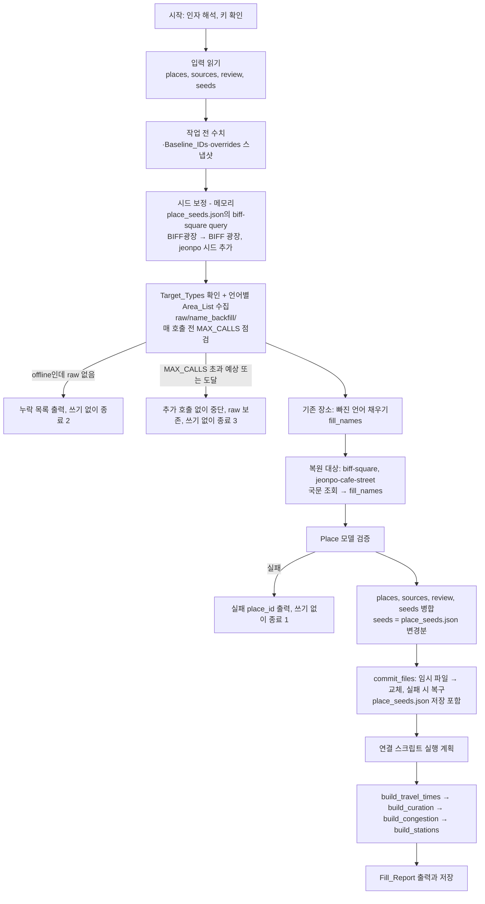

# 설계 문서

## Overview

`places.json`의 장소 33곳 중 외국어 이름이 비어 있는 칸을 채우는 일회성 스크립트 `backend/scripts/backfill_names.py`를 설계한다. 데모 손님이 일본인 커플이라 ja 빈칸(9곳)이 가장 급하다.

기존 `fetch_places.py`는 외국어 서비스의 `locationBasedList2`(국문 좌표 반경 조회)를 쓴다. 이 API는 항목을 빠뜨린다. `fetch_restaurants.py`가 같은 문제를 `areaBasedList2`(부산 전체 목록)로 풀었으므로 같은 방식을 쓴다.

핵심 방침은 다음과 같다.

- 외국어 4개 서비스(EngService2, JpnService2, ChsService2, ChtService2)의 `areaBasedList2`(`lDongRegnCd=26`)를 관광 타입별로 모두 받아 raw에 저장한다.
- 일치 판단은 `fetch_places`의 `pick_foreign`, `normalize_korean`, `strip_korean`, `haversine_m`, `match_kind`를 import해서 쓴다. 규칙을 다시 구현하지 않는다.
- 비어 있는 언어만 채운다. 이미 있는 이름, 좌표, `category`, `indoor`, `nearest_station`, `place_id`는 바꾸지 않는다.
- 이름은 외국어 title에서 `strip_korean`으로 얻은 값만 쓴다. 번역하거나 새로 만들지 않는다.
- 판단 로직은 파일·네트워크·시각을 쓰지 않는 순수 함수(`fill_names`)로 분리해 `parametrize` 기반 속성 테스트로 검증한다(`hypothesis`는 쓰지 않는다).
- 한 번의 실행이 보낼 HTTP 요청 수를 사전 추정하고 상한 `MAX_CALLS`로 막는다(「API 호출 수 추정과 상한」).
- `biff-square`(국문 재검색)와 `jeonpo-cafe-street`(복원)도 같은 스크립트가 처리하고, 새 장소가 생기면 연결 스크립트 4개를 다시 실행한다.

변경 파일은 새 스크립트 `backend/scripts/backfill_names.py`, 시드 파일 `backend/scripts/place_seeds.json`(biff-square의 `query`를 `"BIFF광장"`에서 `"BIFF 광장"`(띄어쓰기)으로 바꾸고, 없으면 jeonpo-cafe-street 시드를 추가), `backend/app/data/`의 `places.json`·`places_sources.json`·`places_review.csv`·`raw/name_backfill/`와 연결 스크립트가 다시 만드는 파생 파일, 테스트 `backend/tests/test_name_backfill.py`다. 작업 범위는 `backend/app/data/`와 `backend/scripts/`다. 공용 파일(`backend/app/models/`, `docs/api-contract.md`, `backend/app/handler.py`, `.kiro/steering/team.md`)과 `fetch_places.py`, `fetch_restaurants.py`는 수정하지 않는다. commit과 push는 하지 않는다.

### 조사 결과 (설계에 반영한 사실)

| 확인한 것 | 결과 | 설계에 준 영향 |
|---|---|---|
| `places.json` | 33곳. ja 없음: the-bay-101, busan-x-the-sky, sea-life-busan, busan-cinema-center, lotte-world-busan, lotte-outlet-dongbusan, songdo-cable-car, busan-citizens-park, busan-museum (9곳) | 요구사항과 일치 |
| `places.json` 줄바꿈 | `places.json`, `places_sources.json`, `places_review.csv` 모두 CRLF (`fetch_places`가 Windows에서 `write_text`로 씀) | 새 쓰기도 CRLF로 맞춰 diff가 줄 전체로 번지지 않게 한다 |
| 외국어 raw의 `contenttypeid` | 76, 78, 80, 82, 79, 75가 보임 (국문 12·14·38과 번호 체계가 다름) | Target_Types 후보는 75, 76, 78, 79. 80(숙박)과 82(음식점)는 뺀다. 실행 중 응답으로 검증한다 |
| `fetch_restaurants.py` | 외국어 `areaBasedList2`에 `lDongRegnCd=26`, `arrange=C`, `numOfRows=100`, 쪽 반복이 동작함 | 같은 파라미터 형식을 쓴다 |
| `fp._call_and_save` | raw에 같은 `(service, operation, params)` 응답이 있으면 재사용. `OFFLINE`은 없으면 실패 | 1.5, 8.2, 8.3, 8.7을 이 함수로 만족한다 |
| `place_seeds.json` | `biff-square` 시드는 있고(`query: "BIFF광장"`), `jeonpo-cafe-street` 시드는 없다. 둘 다 `places.json`에 없다 | 5번, 6번이 시드 수정·추가를 포함한다 |
| `build_congestion.PLACE_NAMES` | `biff-square`, `jeonpo-cafe-street` 둘 다 이미 있다. `raw/congestion_busan.json`도 있다 | 7.4 경고 대상은 현재 없을 가능성이 높다. 그래도 일반 코드로 처리한다 |
| `build_curation` | `foreigner_friendly`가 `names`의 언어 수에서 나온다. `curation_overrides.json`은 현재 `{}` | 이름만 채워져도 `build_curation`을 다시 실행해야 한다(7.3) |
| `hypothesis` | `pyproject.toml`에 없다 | 추가하지 않는다. `pytest.mark.parametrize`와 고정 시드 난수 입력으로 속성을 검증한다 (아래 「Testing Strategy」, 「결정 사항」) |
| `place_seeds.json` biff-square | `query`가 `"BIFF광장"`. `raw/biff-square/ko.json`에 이 키워드의 응답이 0건으로 저장되어 있다 | `query`를 `"BIFF 광장"`(띄어쓰기)으로 바꿔 저장하고 `searchKeyword2`를 1회 호출한다 (5.1) |
| 기존 raw의 쪽 크기·건수 | `fetch_restaurants`는 `numOfRows=100`, `arrange=C`. `raw/restaurants/en_p1.json`의 외국어 음식점(타입 82) `totalCount`=26, `fetch_places`의 좌표 반경 조회는 `numOfRows=20`이라 부산 전체 건수를 알 수 없다 | 쪽 크기 100을 쓴다. 관광 타입별 부산 전체 `totalCount`는 기존 raw에 없으므로 「API 호출 수 추정과 상한」에서 가정치를 쓰고 첫 호출에서 확정한다 |

## Architecture

### 처리 흐름



### 설계 결정

| # | 결정 | 이유 |
|---|---|---|
| D1 | 새 스크립트 하나(`scripts/backfill_names.py`)에 순수 로직과 입출력을 함께 둔다. 순수 함수는 파일 위쪽 「순수 함수」 구역에 모은다 | 저장소 스크립트(`fetch_places.py` 등)가 같은 구성이다. 테스트는 순수 구역만 직접 부른다 |
| D2 | raw 저장 위치는 `app/data/raw/name_backfill/<lang>_t<type>_p<page>.json` | 요구사항 1.2의 "언어별·타입별·쪽별 파일 하나씩". 장소별 raw(`raw/<place_id>/`)와 섞이지 않는다. `raw/`는 git에 올리지 않는다 |
| D3 | `fp.REUSE_RAW`를 항상 켠다. `--reuse-raw`는 받되 효과는 같다. `--offline`은 `fp.OFFLINE`으로 넘긴다 | 1.5(저장된 응답이 있으면 재호출 없음)가 기본 동작이어야 한다. 8.7의 `--reuse-raw` 지정도 그대로 통한다 |
| D4 | Target_Types 확인은 별도 호출 없이 각 언어·타입의 1쪽 응답으로 한다. 1쪽 응답의 모든 항목 `contenttypeid`가 요청한 번호와 같아야 2쪽 이후와 다음 타입을 받는다 | 확인용 반복 호출을 0회로 유지한다(8.1). 1쪽은 어차피 필요한 요청이고 raw에 저장되어 재사용된다. 아래 「결정 사항」에 확정 내용을 적었다 |
| D5 | 순수 함수가 "이미 review에 있는 (place_id, lang) 쌍"(`known_reviews`)을 입력으로 받고, 그 쌍에는 새 review 행을 만들지 않는다 | 10.3의 멱등 속성(두 번째 적용에서 추가 review 0건)과 4.3(못 채운 행은 변경 없이 유지)을 함께 만족한다 |
| D6 | 후보를 `contentid` 오름차순으로 정렬해 `pick_foreign`에 넘긴다 | `pick_foreign`은 거리가 같을 때 입력 순서를 따른다(안정 정렬). 정렬하면 2.11(거리가 같으면 `contentid`가 작은 쪽)이 규칙 재구현 없이 성립한다 |
| D7 | Sources_File의 `apis[lang]`은 `"JpnService2/areaBasedList2"` 형식으로 쓴다 | 기존 값은 서비스 이름만 있다. 4.2의 "다른 API로 찾은 항목과 구분"을 만족한다. `apis`를 읽는 코드는 저장소에 없다(검색 확인) |
| D8 | 쓰기는 임시 파일에 먼저 모두 쓴 뒤 `os.replace`로 교체하고, 도중에 실패하면 메모리에 둔 원본 바이트로 되돌린다 | 4.8. 세 파일(과 시드 파일)이 서로 어긋난 채 남지 않는다 |
| D9 | 연결 스크립트는 `main()`을 같은 프로세스에서 순서대로 부른다. 실행 목록은 인자로 주입할 수 있게 한다 | 테스트에서 실제 `app/data/` 파생 파일을 건드리지 않는다. 실패(0이 아닌 반환값)에서 멈추는 로직을 가짜 러너로 검증한다 |
| D10 | 새 장소는 `places.json` 끝에 시드 순서대로 붙인다 | 기존 33곳의 순서와 줄이 바뀌지 않아 diff가 작다 |
| D11 | 언어 전체 호출 실패는 `place_id="*"`, `lang=<언어>`, `reason="api_error: <사유>"` 행으로 review에 남긴다. 다음 실행에서 그 언어가 성공하면 이 행을 지운다 | 1.6. 장소 단위 행과 구분되고 재실행 후 낡은 오류가 남지 않는다 |

## Components and Interfaces

### 상수와 입력

```python
REGION_CODE = "26"
AREA_ROWS = 100                    # 한 쪽에 받는 건수
MAX_PAGES = 50                     # 무한 반복 방지. 넘으면 1.7 경고
EXPECTED_CALLS = 30                # 사전 추정 호출 수 (「API 호출 수 추정과 상한」 표). 보고서에 같이 적는다
MAX_CALLS = 60                     # 한 번의 실행에서 보낼 HTTP 요청 상한 (재시도 포함). EXPECTED_CALLS × 1.5
SEEDS_PATH = fp.SCRIPTS_DIR / "place_seeds.json"   # biff-square query 변경과 jeonpo-cafe-street 시드 추가를 저장
TARGET_TYPES = ("76", "78", "79", "75")   # 외국어 관광타입: 관광지, 문화시설, 쇼핑, 레포츠. 실행 중 검증한다
NAME_LANGS = fp.NAME_LANGS         # ["en", "ja", "zh-Hans", "zh-Hant"]
RAW_DIR = fp.RAW_DIR / "name_backfill"
RESTORE_SEEDS = {                  # 복원 대상 시드 보정 (메모리에서 적용, 성공하면 seeds 파일에 저장)
    "biff-square": {"query": "BIFF 광장"},
    "jeonpo-cafe-street": {"place_id": "jeonpo-cafe-street", "name_ko": "전포카페거리", "query": "전포카페거리",
                           "keywords": {"en": "Jeonpo Cafe Street"}, "category": "street", "indoor": False},
}
```

`TARGET_TYPES`는 설계 시점의 후보다. 구현 단계에서 1쪽 응답으로 확인한 번호만 남긴다. 확인 근거는 Fill_Report에 쓴다.

### 순수 함수 (네트워크·파일·환경 변수·현재 시각을 쓰지 않는다)

```python
@dataclass(frozen=True)
class FilledName:
    name: str        # strip_korean 결과
    contentid: str
    match: str       # "exact" | "contains"
    radius_m: int    # 300 | 1000
    dist_m: int


@dataclass(frozen=True)
class FillResult:
    names: dict[str, str]            # 기존 names + 이번에 채운 이름 (언어 순서는 NAME_LANGS)
    filled: dict[str, FilledName]    # 이번에 채운 언어만
    reviews: list[dict]              # 새 review 행 {place_id, name_ko, lang, reason, candidates}


def fill_names(place_id: str, name_ko: str, kor: dict, names: dict[str, str],
               candidates: dict[str, list[dict]],
               known_reviews: frozenset[tuple[str, str]] = frozenset()) -> FillResult:
    """빠진 언어만 Area_List 후보에서 채운다. 기존 값은 그대로 둔다.

    kor: {"title", "lat", "lng"} 국문 기준. candidates: 언어 → parse_items 형식의 후보 목록
    (언어 키가 없으면 그 언어는 수집 실패라 건드리지 않는다).
    """
```

`fill_names`의 처리 순서는 다음과 같다.

1. 빠진 언어 = `NAME_LANGS` 중 `names`에 없거나 값이 공백뿐인 언어이면서 `candidates`에 키가 있는 언어.
2. 언어마다 후보를 정리한다(`sanitize_candidates`). dict가 아니거나, `contentid`·`lat`·`lng`가 없거나, `title`이 None·빈 문자열·공백뿐인 후보는 건너뛴다(10.9). 건너뛴 것은 이름을 바꾸지 않는다.
3. 정리한 후보를 `contentid` 오름차순(숫자면 숫자 순서)으로 정렬한다(D6).
4. `fp.pick_foreign(kor, 후보, 300)`을 부르고, 선택이 없으면 `fp.pick_foreign(kor, 후보, 1000)`을 부른다. `fp.find_foreign_name`과 같은 2단계 순서다.
5. 선택이 있으면 `FilledName`을 만든다. 같은 `match`이면서 `strip_korean` 이름이 다른 후보가 반경 후보(`near`)에 더 있으면 review 행을 남긴다(2.10, 2.11). 거리까지 같으면 사유 `distance_tie`, 아니면 `ambiguous_match`다. 후보 목록에 선택한 후보를 포함한다.
6. 선택이 없으면 사유를 정해 review 행을 남긴다. 단 `known_reviews`에 `(place_id, lang)`이 있으면 행을 만들지 않는다(D5).

못 채운 언어의 사유는 아래 표로 정한다.

| `pick_foreign` 결과 | review 사유 | 근거 |
|---|---|---|
| `no_korean_match`, 건너뛴 후보 없음 | `no_korean_match` | 2.7 |
| `no_korean_match`이고 반경 1000m 안에 건너뛴(title 없음) 후보가 있음 | `empty_name` | 2.8 |
| `title_without_korean` (`pick_foreign`이 돌려주는 사유. 후보에 한글이 없음) | `empty_name` | 2.3. 이름을 얻을 수 없는 경우는 모두 `empty_name` 하나로 적는다 |
| `empty_name` (일치했지만 한국어를 빼면 이름이 빔) | `empty_name` | 2.3. `fetch_places`와 같은 사유 이름 (「결정 사항」 1) |

기타 순수 함수는 다음과 같다.

| 함수 | 입력 → 출력 | 요구사항 |
|---|---|---|
| `missing_langs(names)` | `names` → 빠진 언어 목록 | 2.1, 9 |
| `sanitize_candidates(cands)` | 후보 목록 → (쓸 수 있는 후보, 건너뛴 후보) | 10.5, 10.9 |
| `apply_fill(place, result)` | 장소 dict + `FillResult` → 새 장소 dict. `names` 외 필드는 그대로 | 2.5, 2.6 |
| `merge_sources(old, updates)` | 기존 Sources + 채운 (place, lang) 항목 → 새 Sources. 다른 항목은 값 그대로 | 4.1, 4.2 |
| `merge_review(old_rows, filled_pairs, new_rows, api_ok_langs)` | 기존 review 행 + 이번에 채운 쌍 + 새 행 → 새 행 목록 | 4.3, 4.4, D11 |
| `plan_pages(total, rows)` | `totalCount`, 쪽 크기 → 받을 쪽 번호 목록 (최소 1쪽) | 1.1 |
| `plan_linked_steps(baseline_ids, new_ids, filled_count)` | → 실행할 스크립트 이름 목록 | 7.1, 7.3 |
| `run_chain(steps, runners)` | 이름 목록 + 이름→실행 함수 → (실행한 목록, 실패한 이름 또는 None). 첫 실패에서 멈춘다 | 7.2 |
| `count_names(places)` | 장소 목록 → 언어별 이름 보유 수 | 9.1 |
| `remaining_gaps(places)` | 장소 목록 → 비어 있는 (place_id, 언어) 쌍 | 9.4 |
| `check_budget(used, pending_calls, max_calls)` | 이번 실행에서 이미 보낸 요청 수, 앞으로 반드시 필요한 호출 수, 상한 → `None`(진행) 또는 중단 사유 문자열 | 8.1 |
| `dump_sources(sources)`, `dump_review(rows)` | → 파일 바이트 (CRLF, 각각 BOM 없음 / `utf-8-sig`) | 4.5, 4.6 |

`dump_places`는 `fp.dump_places`를 그대로 쓰고 줄바꿈만 CRLF로 바꾼다(4.7).

### 입출력 구역

| 함수 | 하는 일 |
|---|---|
| `fetch_area_list(lang, log)` | 타입마다 1쪽부터 `plan_pages`가 정한 쪽까지 `fp._call_and_save`로 받는다. 응답 원본 항목 수가 `totalCount`보다 적으면 경고(1.7). 1쪽 응답의 `contenttypeid`를 검증한다(D4). 타입 번호가 어긋나면 `TargetTypeMismatch`를 올린다 |
| `collect_area_lists(log)` | 4개 언어를 차례로 받는다. 언어 하나가 `FetchError`면 그 언어를 실패로 기록하고 나머지를 계속한다(1.6). offline이면 누락된 raw 경로를 모아 둔다 |
| `load_kor(place_id, sources)` | `raw/<place_id>/ko.json`을 읽어 `places_sources.json`의 국문 `contentid` 항목의 `{title, lat, lng}`를 돌려준다. 파일 없음, JSON 오류, 항목·title·좌표 없음이면 `None`(3.4, 3.5). 국문 API를 부르지 않는다 |
| `resolve_restore(seed, log)` | `fp.search_keyword(query, raw/<place_id>/ko.json)` 1회 → 부산 주소만 남김 → `fp.pick_kor` (5.1~5.4, 6.4) |
| `build_new_place(seed, kor, result, stations)` | 좌표와 `names`가 1개 이상이면 `Place.model_validate`로 검증한 새 장소 dict와 source dict를 만든다. `nearest_station`은 `fp.nearest_station`이 계산한다 (5.6, 5.7, 6.5) |
| `apply_seed_fixes(seeds)` | 메모리의 시드 목록에서 `biff-square`의 `query`를 `"BIFF 광장"`으로 바꾸고, `jeonpo-cafe-street` 시드가 없으면 `RESTORE_SEEDS`의 값으로 추가한다. 바꾼 항목 외의 시드는 그대로다. 바꾼 내용은 `seeds_added`와 보고서에 적는다 (5.1, 6.4, 6.5) |
| `commit_files(writes)` | `{경로: 바이트}`를 임시 파일 → `os.replace`로 교체하고, 실패하면 이전 바이트로 복구한다(D8). `writes`에 `place_seeds.json`의 새 바이트가 들어 있다. 시드 저장은 `places.json` 등과 함께 한 번에 끝나므로, 쓰기 없이 종료하는 경로(offline 누락, 검증 실패, `MAX_CALLS` 중단)에서는 시드 파일도 바뀌지 않는다 |
| `CallLog` | `fp.API_CALLS` 증가량을 `(서비스, 작업)`별로 합산한다. `_call_and_save` 호출 전후 차이로 센다 (8.6) |
| `CallBudget` | 실행 시작 시점의 `fp.API_CALLS`를 기준으로 이번 실행에서 실제 보낸 HTTP 요청 수(`used`)를 돌려주고, 호출 전 `check_budget`으로 상한을 점검한다. 중단하면 `BudgetExceeded`를 올린다 (「API 호출 수 추정과 상한」) |
| `render_report(...)` | Fill_Report 문자열. 표준 출력과 `raw/name_backfill/fill_report.md`에 쓴다 |
| `main(argv)` | 위 흐름을 실행한다 |

### CLI

```text
uv run --env-file .env python -m scripts.backfill_names                # 전체 실행 (실제 호출, 1회)
uv run --env-file .env python -m scripts.backfill_names --reuse-raw    # 재실행: 저장된 쪽은 재호출 없음
uv run python -m scripts.backfill_names --offline                      # 호출 0회, raw만 사용
```

종료 코드는 다음과 같다.

| 코드 | 뜻 |
|---|---|
| 0 | 정상 |
| 1 | 일부 언어 호출 실패, 연결 스크립트 실패, 모델 검증 실패, 파일 쓰기 실패 |
| 2 | `--offline`인데 필요한 raw 누락 (쓰기 없음) |
| 3 | 호출 상한 `MAX_CALLS` 도달 또는 초과 예상으로 중단 (쓰기 없음, 이미 받은 raw 보존) |

Target_Types 불일치(1.9)는 쓰기 없이 종료 코드 1로 끝난다.

## Data Models

### Area_List 후보 (`fp.parse_items` 형식 그대로)

```python
{"contentid": "3115072", "title": "ヘリダンギル（해리단길）", "addr1": "...", "lat": 35.16, "lng": 129.15}
```

`parse_items`는 `contenttypeid`를 버린다. 타입 검증은 같은 응답을 `festival_items`(`fetch_events`, `fetch_restaurants`가 쓰는 원본 항목 추출 함수)로 읽어 한다.

### raw 파일

`fp._call_and_save`가 쓰는 형식 `{"service", "operation", "params", "response"}`를 그대로 쓴다. `serviceKey`는 저장되지 않는다.

```text
app/data/raw/name_backfill/
  ja_t76_p1.json, ja_t76_p2.json, ja_t78_p1.json, ...
  en_t76_p1.json, ...   (zh-Hans, zh-Hant 동일)
  fill_report.md
```

요청 파라미터는 `{"contentTypeId": t, "lDongRegnCd": "26", "arrange": "C", "numOfRows": 100, "pageNo": n}`다.

### places_sources.json 항목 갱신

채운 (장소, 언어) 조합에 대해서만 다음을 쓰고, 나머지 키·값은 읽은 그대로 둔다.

```json
{
  "apis":        { "ja": "JpnService2/areaBasedList2" },
  "contentids":  { "ja": "3115072" },
  "match_kind":  { "ja": "exact" },
  "match_radius_m": { "ja": 300 }
}
```

신규 장소(biff-square, jeonpo-cafe-street)는 `fetch_places.build_place`가 만드는 항목과 같은 키(`provider`, `kor_class`, `foreign_lookup`, `names_overridden`, `station_source`, `fetched_at` 포함)로 쓴다. `foreign_lookup` 설명에는 `areaBasedList2`와 반경 규칙을 적는다. `fetched_at`은 `fp._today()`(`DEMO_NOW` 반영)다.

### places_review.csv 행

열은 기존과 같다: `place_id,name_ko,lang,reason,candidates`. 이 작업이 추가하는 사유는 다음과 같다.

| 사유 | 의미 |
|---|---|
| `no_korean_match`, `empty_name` | 위 표 참고 |
| `ambiguous_match` | 같은 일치 종류의 후보가 둘 이상이고 이름이 달라 가장 가까운 후보를 골랐다 |
| `distance_tie` | 거리까지 같아 `contentid`가 가장 작은 후보를 골랐다 |
| `kor_raw_missing` | `raw/<place_id>/ko.json`이 없거나 읽을 수 없거나 title·좌표가 없어 건너뛰었다 (`lang`은 `ko`) |
| `api_error: <사유>` | 그 언어 호출이 실패했다 (`place_id`는 `*`) |
| `no_candidate`, `multiple_candidates` | 복원 대상의 국문 검색이 0건 또는 후보 다수 (`fp.pick_kor`의 `no_match`, `multiple_candidates`에 대응) |
| `search_failed: <사유>` | 복원 대상의 국문 검색 호출이 재시도 후에도 실패했다 |
| `no_name_found` | 복원 대상의 외국어 이름이 0개라 추가하지 않았다 |
| `missing_category_or_indoor` | 시드에 `category` 또는 `indoor`가 없어 복원하지 않았다 |

`kept_existing` 등 이 작업 대상이 아닌 행은 내용과 순서를 바꾸지 않는다. 인코딩은 `utf-8-sig`, 줄바꿈은 CRLF다.

### Fill_Report

```python
@dataclass
class FillReport:
    before: dict[str, int] | None        # 언어별 이름 보유 수. 측정 못 하면 None → "측정 안 됨"
    after: dict[str, int]
    target_type_check: list[dict]        # {lang, type, observed_types, ok}
    haeundae_ja: dict[str, dict]         # place_id → {name, match, dist_m} 또는 {reason}
    restored: dict[str, dict]            # biff-square, jeonpo-cafe-street → {added, name | reason}
    seeds_added: list[str]               # 추가한 시드
    missing_inputs: list[str]            # 없던 시드·좌표·raw 종류 (6.4)
    gaps: list[tuple[str, str]]          # 작업 후에도 빈 (place_id, lang)
    review_counts: dict[str, int]        # 사유별 남은 행 수
    api_calls: dict[tuple[str, str], int]   # (서비스, 작업) → 호출 수, 합계는 정수
    expected_calls: int                  # EXPECTED_CALLS (사전 추정치)
    max_calls: int                       # MAX_CALLS (상한)
    stopped_by_budget: str | None        # 상한으로 멈췄다면 멈춘 위치(언어, 타입, 쪽), 아니면 None
    linked: dict[str, bool]              # 스크립트 → 실행함 여부
    failed_langs: list[str]
    warnings: list[str]                  # totalCount 경고, 역 표 경고, PLACE_NAMES 경고 등
```

작업 전 수치는 `places.json`을 처음 읽은 직후, 어떤 파일도 쓰기 전에 `count_names`로 측정한다(9.6). 측정이 실패하면 `before=None`이고 보고서에 "측정 안 됨"만 쓴다(9.7). "5곳을 6곳으로" 같은 추정값은 쓰지 않는다.

## Correctness Properties

*A property is a characteristic or behavior that should hold true across all valid executions of a system-essentially, a formal statement about what the system should do. Properties serve as the bridge between human-readable specifications and machine-verifiable correctness guarantees.*

**구현 방식:** 각 속성은 `hypothesis` 없이 `pytest.mark.parametrize` 테스트 하나로 구현한다. 입력은 손으로 고른 경계 케이스와 `random.Random(고정 시드)`로 만든 난수 입력을 합쳐 속성마다 100개 이상이다(10.8, 「Testing Strategy」).

**속성 중복 검토 (Reflection)**

prework에서 PROPERTY로 분류한 항목을 합쳤다.

- 2.5, 2.6, 10.2는 "채우기는 기존 값을 건드리지 않는다"는 같은 불변이므로 속성 1 하나로 합쳤다.
- 2.2, 2.9, 10.4는 "이름은 후보의 `strip_korean` 값뿐"이라는 같은 내용이므로 속성 3 하나로 합쳤다.
- 10.5와 10.9는 "쓸 수 없는 후보는 없는 것과 같다"로 합쳐 속성 4가 됐다.
- 2.10, 2.11, 6.2는 동률 처리 규칙이라 속성 6 하나로 합쳤다.
- 4.3과 4.4, 2.4와 4.1과 4.2, 4.5와 4.7과 10.6, 1.5와 8.7과 8.1, 7.1과 7.3은 각각 같은 함수의 같은 성질이라 합쳤다.
- 2.7과 2.3은 "못 채운 언어는 사유가 있는 review 한 행"으로 합쳤다. 속성 2(멱등)가 `known_reviews` 때문에 이 성질과 겹치지 않는지는 속성 2에서 따로 확인한다.

### Property 1: 채우기는 기존 값을 바꾸지 않는다

*For any* 장소 dict(임의의 `names`, 좌표, `category`, `indoor`, `nearest_station`)와 임의의 후보 목록에 대해, `fill_names` 결과의 `names`는 입력 `names`의 모든 키와 값을 그대로 포함하고(키 집합이 입력 키 집합을 포함), `apply_fill`을 적용한 장소의 `names` 외 모든 필드(`place_id`, `lat`, `lng`, `category`, `indoor`, `nearest_station`)는 입력과 같다.

**Validates: Requirements 2.5, 2.6, 10.2**

### Property 2: 같은 입력으로 다시 적용해도 결과가 같다

*For any* 장소와 후보 목록에 대해, 첫 번째 `fill_names` 결과의 `names`를 기존 `names`로 삼고, 첫 번째 review 행들의 `(place_id, lang)`을 `known_reviews`로 넘겨 같은 후보 목록으로 다시 적용하면 `names`는 첫 번째 결과와 같고 새 review 행은 0건이다.

**Validates: Requirements 10.3**

### Property 3: 이름은 후보 title의 strip_korean 값뿐이다

*For any* 기존 `names`와 후보 목록에 대해, 기존 `names`에 없던 키에 새로 채운 모든 이름은 해당 언어 후보 title에 `strip_korean`을 적용한 값 중 하나와 정확히 같고 비어 있지 않다. 후보 목록이 비어 있으면 새로 채운 이름은 0건이다.

**Validates: Requirements 2.2, 2.9, 10.4**

### Property 4: 쓸 수 없는 후보는 없는 것과 같다

*For any* 후보 목록과 그 안에 섞은 불량 후보(title이 None·빈 문자열·공백뿐, 필드 누락, dict가 아닌 값)에 대해, `fill_names`는 예외를 내지 않고 결과 `names`가 불량 후보를 제거한 목록의 결과와 같다. *For any* API 응답의 `items` 형태(빈 문자열, 단일 dict, 목록, 0건)에 대해 `fp.parse_items` 뒤의 처리는 예외를 내지 않는다. 후보가 0건이면 `names`는 입력과 같다.

**Validates: Requirements 10.5, 10.9**

### Property 5: 후보 선택이 기존 일치 규칙과 같다

*For any* 국문 기준과 `contentid` 오름차순으로 정렬된 후보 목록에 대해, `fill_names`가 어떤 언어에 채운 이름·`contentid`·`match`는 `fp.pick_foreign(kor, 후보, 300)`을 먼저, 없으면 `fp.pick_foreign(kor, 후보, 1000)`을 부른 결과와 같고, 두 호출 모두 선택이 없으면 그 언어는 채워지지 않는다.

**Validates: Requirements 2.1, 3.2**

### Property 6: 같은 종류 후보가 여럿이면 가장 가까운 것, 거리까지 같으면 contentid가 작은 것

*For any* 같은 `match` 종류이고 `strip_korean` 이름이 서로 다른 후보 집합과 임의의 입력 순서에 대해, 선택된 후보는 거리가 가장 작은 후보이고, 거리가 같은 후보가 둘 이상이면 그중 `contentid`가 가장 작은 후보다. 이때 review 행이 1건 생기며 그 `candidates`에 선택한 후보를 포함한 모든 후보가 들어 있다.

**Validates: Requirements 2.10, 2.11, 6.2**

### Property 7: 못 채운 언어는 사유가 있는 review 행이 정확히 한 건이다

*For any* 장소와 후보 목록에서 빠진 언어 중 채우지 못한 언어마다 `known_reviews`에 없으면 review 행이 정확히 1건이고, 그 사유는 `no_korean_match`, `empty_name` 중 하나다. 채운 언어는 이 사유의 행이 없다. 수집에 실패해 후보 키가 없는 언어는 이름도 행도 바뀌지 않는다.

**Validates: Requirements 2.3, 2.7, 2.8**

### Property 8: 파일 직렬화는 왕복해도 같고 형식을 지킨다

*For any* 한글·일본어·중국어 문자를 포함한 장소 목록과 sources 객체에 대해, 직렬화한 바이트에 BOM이 없고(review 파일은 `utf-8-sig`) `names`가 한 줄이며, 다시 읽은 객체는 저장 전 객체와 모든 키와 값에서 같다.

**Validates: Requirements 4.5, 4.7, 10.6**

### Property 9: review 병합은 채운 쌍의 행만 지운다

*For any* 기존 review 행 목록, 이번에 채운 `(place_id, lang)` 집합, 새 행 목록에 대해, `merge_review` 결과에는 채운 쌍의 기존 행이 없고, 채우지 않은 쌍과 `kept_existing` 등 다른 사유의 기존 행은 내용과 상대 순서가 그대로이며 새 행은 그 뒤에 붙는다.

**Validates: Requirements 4.3, 4.4**

### Property 10: sources 병합은 채운 쌍의 항목만 바꾼다

*For any* 기존 sources와 채운 `(place_id, lang)` 집합에 대해, `merge_sources` 결과에서 채운 쌍을 제외한 모든 `contentids`, `apis`, `match_kind`, `match_radius_m` 값은 입력과 같고, 채운 쌍의 `apis` 값에는 `areaBasedList2`가 들어 있으며 `contentids`, `match_kind`가 함께 기록된다.

**Validates: Requirements 2.4, 4.1, 4.2**

### Property 11: 쪽 계획은 totalCount만큼의 건수를 모두 덮는다

*For any* `totalCount` ≥ 0과 쪽 크기 > 0에 대해, `plan_pages`는 1부터 1씩 올라가는 쪽 번호를 돌려주고 쪽 수는 `max(1, ceil(totalCount / 쪽 크기))`이며, 이 쪽들이 담을 수 있는 건수는 `totalCount` 이상이다. 받은 원본 건수가 `totalCount`보다 적으면 경고가 하나 생긴다.

**Validates: Requirements 1.1, 1.7, 8.1**

### Property 12: 저장된 쪽은 다시 호출하지 않는다

*For any* 필요한 쪽 집합과 raw에 이미 저장된 쪽의 부분집합에 대해, 수집이 보내는 요청의 쪽 집합은 저장되지 않은 쪽과 정확히 같다. 모든 쪽이 저장되어 있으면 요청은 0건이다.

**Validates: Requirements 1.5, 8.1, 8.7**

### Property 13: 연결 스크립트는 정해진 순서로 실행되고 첫 실패에서 멈춘다

*For any* Baseline_IDs, 새 `place_id` 집합, 채운 이름 수에 대해, `plan_linked_steps`는 새 ID가 있으면 `build_travel_times`, `build_curation`, `build_congestion`, `build_stations` 순서의 4개를, 새 ID가 없고 채운 이름이 1개 이상이면 `build_curation` 하나를, 둘 다 없으면 빈 목록을 돌려준다. *For any* 실행 목록과 임의의 실패 위치에 대해 `run_chain`이 실행한 목록은 실패한 단계까지의 앞부분이고 그 뒤 단계는 실행하지 않는다.

**Validates: Requirements 7.1, 7.2, 7.3**

### Property 14: 보고 수치는 실제 변화와 맞는다

*For any* 장소 목록과 채움 결과에 대해, 언어별 `count_names` 작업 후 값에서 작업 전 값을 뺀 증감은 그 언어에 새로 채운 이름 수와 같고, `remaining_gaps`는 작업 후 `names`에 없는 `(place_id, lang)` 쌍을 빠짐없이, 중복 없이 나열한다.

**Validates: Requirements 9.1, 9.4**

## Error Handling

| 상황 | 처리 | 요구사항 |
|---|---|---|
| 외국어 호출이 타임아웃·5xx·형식 오류 | `fp.request_json`이 5초 타임아웃, 재시도 1회 후 `FetchError`. 키는 예외 메시지에 넣지 않는다 | 1.3 |
| 한 언어의 호출 실패 | 그 언어 전체를 실패로 보고 이름을 채우지 않는다(일부 쪽만으로 채우면 `no_korean_match`가 거짓이 된다). review에 `api_error` 행, 나머지 언어는 계속, 종료 시 실패 언어 수 출력, 종료 코드 1. 이미 저장한 raw는 지우지 않는다 | 1.4, 1.6 |
| `totalCount`보다 받은 건수가 적음 | 언어·타입·두 수를 담은 경고를 출력하고 보고서에 남긴다. 처리는 계속한다 | 1.7 |
| Target_Types 번호가 응답의 `contenttypeid`와 다름 | 이후 쪽과 타입 호출을 시작하지 않고, 불일치 번호를 보고서에 쓰고, 오류 출력 후 비정상 종료. 쓰기 없음 | 1.9 |
| 1쪽 응답이 0건이라 번호를 확인할 수 없음 | 불일치로 보지 않고 "확인 불가"로 기록하고 경고한다 | 1.8 |
| `--offline`인데 raw 없음 | API를 부르지 않고 누락된 서비스·작업·쪽(파일 경로)을 모두 모아 출력한 뒤 쓰기 없이 비정상 종료. raw는 건드리지 않는다 | 8.3 |
| `DATA_GO_KR_KEY_DECODING`이 비어 있고 offline이 아님 | 시작 전에 메시지를 출력하고 종료 코드 1 | `fetch_places`와 같은 동작 |
| `raw/<place_id>/ko.json` 없음·JSON 오류·title 또는 좌표 없음 | 그 장소를 건너뛰고 `kor_raw_missing` 행을 남긴다. 장소 항목과 raw는 수정하지 않는다 | 3.5, 3.6 |
| 후보에 title 없음 | 그 후보만 건너뛴다 | 10.9 |
| 복원 대상의 국문 검색 결과 0건·후보 다수 | 장소를 추가하지 않고 사유와 후보(제목, 주소, 좌표)를 review에 남긴다 | 5.3, 6.3 |
| 복원 대상의 국문 검색 호출 실패 | 추가하지 않고 `search_failed` 행을 남기고 오류를 출력한다. 종료 코드 1 | 5.4 |
| 복원 대상의 `category`·`indoor` 없음 | 추가하지 않고 `missing_category_or_indoor` 행 | 6.6 |
| 복원 대상의 외국어 이름 0개 | 추가하지 않고 `no_name_found` 행 | 5.7 |
| 이번 실행의 실제 호출 수가 `MAX_CALLS`에 닿거나, 닿을 것으로 예상됨 | 추가 호출 없이 그 자리에서 멈춘다. 이미 받은 raw는 지우지 않고, `places.json`·sources·review·`place_seeds.json`을 쓰지 않으며, 호출 수 표(8.6)를 출력하고 종료 코드 3. 메시지 형식은 「API 호출 수 추정과 상한」 | 8.1, 8.6, 8.7 |
| `Place` 검증 실패 | `places.json`을 쓰지 않고 실패한 `place_id`를 출력하고 종료 코드 1 | 2.12 |
| 파일 쓰기 중 오류 | 임시 파일을 지우고 이미 교체한 파일은 메모리의 원본 바이트로 되돌린다. 한국어 로그와 종료 코드 1 | 4.8 |
| 연결 스크립트가 0이 아닌 값을 반환 | 남은 단계를 실행하지 않고 실패한 단계 이름을 보고서에 쓴다. 이미 만든 파생 파일은 그대로 둔다. 종료 코드 1 | 7.2 |
| 연결 스크립트가 예외를 올림 | 0이 아닌 반환과 같이 처리한다 | 7.2 |
| `curation_overrides.json`이 실행 전후로 다름 | 보고서에 경고하고 종료 코드 1 (이 스크립트는 그 파일을 쓰지 않는다) | 7.6 |
| 새 장소의 `nearest_station`이 `stations.json`에 없음 | `place_id`와 값을 경고로 보고서에 쓰고 계속한다 | 7.5 |
| 새 장소가 `build_congestion.PLACE_NAMES`에 없음, 또는 결과 `congestion.json`에 값이 없음 | "요일 규칙 대체 대상"으로 `place_id`와 함께 보고한다 | 7.4 |

로그와 주석은 한국어로 쓴다. 로그, 보고서, raw 어디에도 `serviceKey` 값을 쓰지 않는다.

## API 호출 수 추정과 상한

일일 호출 한도를 아끼는 것이 목적이다(요구사항 8). 호출 수를 미리 추정하고, 실행 중 상한을 넘기면 멈춘다.

### 호출 수 식

```text
호출 수 = 4개 언어 × 타입 수 × 타입별 쪽 수
        + biff-square searchKeyword2 1회
        + jeonpo-cafe-street 국문 조회 1회 (raw/jeonpo-cafe-street/ko.json이 없을 때만)
```

- 쪽 수 = `max(1, ceil(totalCount / 100))`. 쪽 크기는 `fetch_restaurants.py`의 `ROWS=100`과 같다. `fetch_places.py`의 `numOfRows=20`은 좌표 반경 조회용이라 이 계산에 쓰지 않는다.
- 저장된 쪽은 다시 부르지 않으므로(1.5) `--reuse-raw` 재실행의 새 호출 수는 아직 없는 쪽 수뿐이다.
- 재시도(최대 1회)는 호출 수에 센다(`fp.API_CALLS`와 같은 기준). 재시도는 상한의 여유분(아래 `MAX_CALLS` 산출)에 포함한다.
- 시드 추가는 API 호출이 아니므로 호출 수에 넣지 않고 `seeds_added`에 따로 적는다.

### 근거 확인과 가정

저장소의 기존 raw와 스크립트에서 확인한 것과 확인할 수 없는 것을 구분한다.

| 항목 | 값 | 근거 |
|---|---|---|
| 쪽 크기 `numOfRows` | 100 (확인) | `fetch_restaurants.py`의 `ROWS=100`, `raw/restaurants/en_p1.json` 요청 파라미터 `numOfRows: 100` |
| 부산 전체 목록 호출 방식 | `areaBasedList2`, `lDongRegnCd=26`, `arrange=C`, `pageNo` 반복 (확인) | `fetch_restaurants.fetch_pages`, 같은 raw 파일의 `params` |
| 외국어 음식점(타입 82)의 `totalCount` | en 26 (확인). ja·zh-Hans·zh-Hant는 수십 건으로 모두 1쪽이다 (`fetch_restaurants.py` 머리 설명, 각 `*_p1.json`만 있음) | `raw/restaurants/en_p1.json`의 `totalCount: 26` |
| 국문 음식점 `totalCount` | 약 510건, 6쪽 (확인) | `fetch_restaurants.py` 머리 설명, `raw/restaurants/ko_p1~p6.json` |
| 외국어 관광 타입(75·76·78·79)의 부산 전체 `totalCount` | 알 수 없음 | `raw/<place_id>/` 아래 외국어 raw는 좌표 반경 조회(`numOfRows=20`)라 부산 전체 건수가 없다. 외국어 raw에서 `contenttypeid`가 75·76·78·79·80·82로 보이는 것만 확인했다 |

관광 타입의 `totalCount`는 기존 raw로 확인할 수 없다. 아래 표의 쪽 수는 가정치이며 **첫 호출에서 확정**한다. 가정은 "외국어 서비스의 부산 전체 건수는 같은 타입의 국문 건수보다 훨씬 적다"는 것이다(외국어 음식점이 국문 약 510건 대비 수십 건인 것에서 가져온 추정이며 관광 타입에도 같다는 보장은 없다). 틀리면 아래 상한 점검이 막는다.

### 타입별 예상 쪽수 (가정치)

| 타입 | 번호 | 예상 쪽수 (언어당) | 4개 언어 합계 | 상태 |
|---|---|---|---|---|
| 관광지 | 76 | 3 (300건 이하 가정) | 12 | 첫 호출에서 확정 |
| 문화시설 | 78 | 2 (200건 이하 가정) | 8 | 첫 호출에서 확정 |
| 쇼핑 | 79 | 1 | 4 | 첫 호출에서 확정 |
| 레포츠 | 75 | 1 | 4 | 첫 호출에서 확정 |
| 합계 | | 7 | 28 | |

| 항목 | 호출 수 |
|---|---|
| Area_List 수집 (4개 언어 × 7쪽) | 28 |
| biff-square `searchKeyword2` (`"BIFF 광장"`) | 1 |
| jeonpo-cafe-street 국문 조회 (`raw/jeonpo-cafe-street/ko.json`이 없을 때만) | 0~1 (여유를 위해 1로 센다) |
| **예상 총 호출 수 `EXPECTED_CALLS`** | **30** |
| 하한 (모든 타입이 1쪽) | 16 + 1 = 17 |

현재 `raw/jeonpo-cafe-street/` 폴더는 있으므로 국문 조회는 실제로는 필요 없을 가능성이 크다. 그래도 상한 계산에는 포함한다.

### 상한 `MAX_CALLS`

- `MAX_CALLS = 60`. 코드 상수로 두고, 호출 전에 추정 표와 맞는지 보고서에 `expected_calls`, `max_calls`로 같이 남긴다.
- 1.5배의 여유는 재시도와 가정치 오차를 위한 것이다. 첫 호출에서 쪽 수가 가정보다 크게 나오면 상한이 먼저 막는다. 상한을 올리려면 사람이 추정 표를 다시 계산하고 상수를 고친다.
- 점검은 두 곳에서 한다. 둘 다 순수 함수 `check_budget`을 쓴다.

```python
def check_budget(used: int, pending_calls: int, max_calls: int) -> str | None:
    """None 이면 진행, 문자열이면 중단 사유. 네트워크·파일을 쓰지 않는다."""
    if used + 2 > max_calls:                  # 다음 호출 1회가 재시도까지 가도 상한 이내여야 한다
        return f"호출 상한 도달: {used}회 사용, 상한 {max_calls}회"
    if used + pending_calls > max_calls:      # 앞으로 반드시 필요한 호출만 더해도 상한을 넘는다
        return f"호출 상한 초과 예상: {used}회 사용 + 필요 {pending_calls}회 > 상한 {max_calls}회"
    return None
```

1. **호출 직전 점검.** 모든 `_call_and_save` 호출 직전에 `check_budget(used, pending, MAX_CALLS)`를 부른다. 저장된 raw를 읽는 호출은 HTTP 요청이 없으므로 점검하지 않고 `used`도 늘지 않는다(`--reuse-raw`로 재실행하면 이미 받은 쪽은 세지 않는다, 8.7).
2. **1쪽 응답 직후 점검(사전 계산).** 어떤 언어·타입의 1쪽 응답에서 `totalCount`를 알게 되면 `pending_calls`를 다시 계산해 점검한다. 이 값은 **"반드시 필요한 최소 호출"**만 센다. 이 타입의 남은 쪽 수(`max(1, ceil(totalCount / 100)) − 1`, 이미 저장된 쪽 제외) + 아직 1쪽을 받지 않은 (언어, 타입)마다 1 + 아직 보내지 않은 국문 조회 수. 아직 모르는 타입의 쪽 수는 최소값 1로 센다. 초과 예상이면 그 타입의 2쪽 이후를 받기 전에 멈춘다.
3. 언어는 `ja`, `en`, `zh-Hans`, `zh-Hant` 순으로 받는다. 상한으로 멈춰도 데모에 가장 급한 ja의 raw가 먼저 저장되어 있다.

`used`는 실행 시작 시점의 `fp.API_CALLS`를 기준으로 한 증가량이다. 재실행마다 새로 세므로 `--reuse-raw` 재실행의 상한은 그 실행에서 새로 보내는 요청에만 적용된다.

### 상한을 넘겼을 때

- 즉시 멈춘다. 이후 어떤 API 호출도 하지 않는다. 이미 받은 raw 파일은 지우거나 고치지 않는다(1.4와 같다).
- `places.json`, `places_sources.json`, `places_review.csv`, `place_seeds.json`을 쓰지 않는다. 연결 스크립트도 실행하지 않는다. 일부 언어만 받은 상태로 이름을 채우면 `no_korean_match`가 거짓이 되기 때문이다(「Error Handling」의 한 언어 호출 실패 행과 같은 이유).
- 종료 코드는 3이다. 표준 오류에 다음 형식으로 한국어 메시지를 낸다. `serviceKey`는 넣지 않는다.

```text
[중단] API 호출 상한 도달: 사용 60회, 상한 60회 (멈춘 위치: ja, 타입 76, 쪽 3)
이미 받은 raw 60개는 그대로 있습니다. 쓰기는 하지 않았습니다.
추정과 다르면 MAX_CALLS를 고친 뒤 --reuse-raw 로 다시 실행하세요. 저장된 쪽은 다시 부르지 않습니다.
```

- 호출 수 표(서비스·작업별, 8.6)와 `stopped_by_budget`을 보고서에 남긴다. 보고서 파일은 `raw/name_backfill/fill_report.md`이며 raw와 같은 폴더라 쓰기 금지 대상이 아니다.

### 요구사항 8과의 연결

| 요구사항 | 이 절이 구현하는 것 |
|---|---|
| 8.1 (Target_Types 수 × 쪽 수만큼만, 확인용 반복 호출 0회) | 호출 수 식과 `MAX_CALLS`가 이 상한을 코드로 강제한다. 타입 확인은 1쪽 응답을 재사용하므로(D4) 확인용 호출이 따로 없고, 상한 점검도 별도 호출을 만들지 않는다. 같은 (서비스, 작업, 파라미터)는 raw를 재사용하므로 반복 호출이 생기지 않는다 |
| 8.5 (전체 실행 정확히 1회) | 상한 중단은 실행 1회를 쓴 것으로 보고, 다시 실행할 때는 `--reuse-raw`(8.7)로 이어 받는다 |
| 8.6 (호출 수 출력) | 상한으로 멈춰도 호출 수 표를 출력한다 |
| 8.7 (`--reuse-raw`에서 저장된 쪽은 다시 호출 안 함) | 저장된 쪽은 `used`에 세지 않고 `pending_calls`에서도 뺀다 |

`--offline`(8.2, 8.3)은 호출이 0회이므로 이 점검과 무관하다.

## Testing Strategy

### 접근

이 기능은 두 층이다. 판단 로직(`fill_names`, 병합, 쪽 계획, 연결 단계 계획, 직렬화)은 순수 함수라 위 「Correctness Properties」를 `parametrize` 기반 속성 테스트로 검증한다(PBT 라이브러리 없이). 외부 API 호출, 파일 쓰기, 연결 스크립트 실행은 입출력이라 가짜 객체와 임시 디렉터리를 쓰는 예시 테스트로 확인한다. 실제 API는 테스트에서 0회 부른다(8.4).

테스트 파일은 `backend/tests/test_name_backfill.py` 하나이고 `uv run pytest tests/test_name_backfill.py`(`backend/`에서)로 키 없이 실행된다.

### 속성 테스트 (parametrize 기반)

- `hypothesis`는 추가하지 않는다. `pyproject.toml`과 `uv.lock`은 건드리지 않는다(info-tools와 같은 결정). 속성(불변·멱등·지어내지 않음·왕복 등)은 `pytest.mark.parametrize` 일반 테스트로 검증한다.
- 속성마다 테스트 함수 하나를 두고, 입력은 두 가지를 합쳐 최소 100개 만든다(10.8).
  - 손으로 고른 `parametrize` 케이스 목록: 경계 입력(후보 0건, 단일 후보, 거리 동률, 빈 title, 한글만 있는 title, 공백뿐인 이름 등).
  - `random.Random(고정 시드)`로 만든 난수 입력. 시드를 상수로 고정해 실패를 그대로 재현할 수 있다. 입력 생성 함수는 테스트 파일 안의 작은 헬퍼로 둔다.
  - 두 입력을 합친 `parametrize` 목록의 길이가 100 이상임을 확인하는 테스트를 각 속성 테스트 옆에 둔다. 중복 입력은 제거하고 센다.
- 각 테스트에 태그 주석을 단다: `# Feature: name-backfill, Property N: <속성 제목>`.
- 입력 생성기는 다음을 포함한다.
  - 한글, 일본어, 중국어, 영문 title과 `（해리단길）` 같은 괄호 병기 title. 한글만 있는 title, 빈 title.
  - 국문 좌표 주변 0~1500m의 좌표와 거리가 같은 후보. `contentid`는 숫자 문자열.
  - `names`가 비었거나 일부만 있는 장소. 값이 공백뿐인 이름.
  - 불량 후보(None title, 필드 누락, dict가 아닌 값).
- 속성 5의 "기존 규칙과 같은 선택"은 `fp.pick_foreign`을 오라클로 쓴다. 이 속성이 `fill_names`가 규칙을 다시 구현하지 않았음(3.1)을 입증한다.

### 예시 테스트 (속성으로 다룰 수 없는 것)

| 대상 | 확인 내용 | 요구사항 |
|---|---|---|
| 1쪽 응답의 타입 검증 | 일치하면 근거 기록, 불일치면 이후 호출 0건·오류, 0건이면 "확인 불가" | 1.8, 1.9 |
| `fetch_area_list` | raw 파일 이름이 `<lang>_t<type>_p<page>.json`이고 키 값이 없음, 2쪽 실패 시 1쪽 파일 유지, 한 언어 실패 시 나머지 언어 계속 | 1.2, 1.4, 1.6 |
| `--offline` | `request_json`이 불리면 실패하는 가짜로 호출 0회, raw가 비면 누락 경로 출력과 쓰기 없음 | 8.2, 8.3 |
| `load_kor` | 정상, 파일 없음, 잘못된 JSON, 좌표 없음 | 3.4, 3.5 |
| 복원 흐름(biff-square) | 호출 1회에 `keyword="BIFF 광장"`, 후보 1건·제목 일치 1건이면 추가, 0건·후보 2건이면 미추가와 review, 호출 실패면 미추가 | 5.1~5.7 |
| 복원 흐름(jeonpo-cafe-street) | 시드 없음 → 시드 추가와 보고, 일치 항목 있음/없음, `category`·`indoor` 없음 | 6.1~6.7 |
| 시드 보정 | `apply_seed_fixes`가 biff-square `query`를 `"BIFF 광장"`으로 바꾸고 다른 시드는 그대로 둠, jeonpo 시드가 있으면 추가하지 않음, `commit_files` 후 `tmp_path`의 `place_seeds.json`에 반영됨 | 5.1, 6.4, 6.5 |
| 호출 상한 | `check_budget`의 경계값(parametrize), 가짜 호출기로 `MAX_CALLS` 도달 시 추가 호출 0건·raw 보존·쓰기 없음·종료 코드 3, 1쪽 `totalCount`로 초과 예상 시 그 타입 2쪽 이후를 부르지 않음, 저장된 쪽만 있는 `--reuse-raw` 재실행은 호출 수에 세지 않음 | 8.1, 8.6, 8.7 |
| `commit_files` | 임시 디렉터리에서 두 번째 교체를 실패시켜 세 파일이 원본 바이트와 같음 | 4.8 |
| `dump_review` | 앞 3바이트가 BOM, `csv`로 읽어 같은 행 | 4.6 |
| 연결 스크립트 | 가짜 러너로 순서, 실패 시 중단, `curation_overrides` 스냅샷 비교 | 7.1~7.6 |
| Fill_Report | 작업 전 수치가 쓰기 전에 기록됨, `before=None`이면 "측정 안 됨", Haeundae_Three의 ja 결과 | 9.2, 9.3, 9.5~9.7 |
| 실제 `app/data/` 불변 | 모든 테스트가 `tmp_path`의 경로를 쓴다. 모듈 상수(`PLACES_PATH` 등)를 `monkeypatch`로 바꾼다 | 10.6 |

### 정적·스모크 확인

- 3.3: `git diff --stat -- backend/scripts/fetch_places.py backend/scripts/fetch_restaurants.py`가 비어 있다.
- 작업 범위: 변경 파일이 `backend/scripts/`(`backfill_names.py`, `place_seeds.json`), `backend/app/data/`, `backend/tests/test_name_backfill.py`에 한정된다. `git diff --stat -- backend/pyproject.toml backend/uv.lock`도 비어 있다.
- 3.1: `backfill_names.py`가 `fetch_places`의 `pick_foreign`, `normalize_korean`, `strip_korean`, `haversine_m`을 import하고, 같은 이름의 함수를 정의하지 않는다.

### 실행 순서와 실제 호출

1. 단위·속성·예시 테스트가 모두 통과한다.
2. `uv run --env-file .env python -m scripts.backfill_names`를 정확히 1회 실행한다(8.5). 호출 수는 4개 언어 × Target_Types 수 × 쪽 수에 biff-square 국문 검색 1회와 필요 시 jeonpo-cafe-street 국문 조회 1회를 더한 값이며, 상한은 「API 호출 수 추정과 상한」의 `MAX_CALLS`다.
3. 실패하면 `--reuse-raw`로 다시 실행한다. 저장된 쪽은 다시 부르지 않는다(8.7).
4. 이후 `--offline`으로 규칙만 바꿔 호출 0회로 다시 만들 수 있다.

## 결정 사항

요구사항과 기존 코드 사이에서 해석이 필요했던 항목을 아래와 같이 확정했다.

1. **review 사유 이름은 `empty_name`이다.** 기존 `fetch_places`와 같은 이름을 쓴다(같은 뜻은 같은 이름). 요구사항 2.3도 `empty_name`으로 고쳤다. 설계 전체에서 `title_without_korean`을 `empty_name`으로 바꿨다. `fetch_places.pick_foreign`이 내부 사유로 돌려주는 `title_without_korean`은 입력 쪽 이름이므로, `fill_names`가 review 행을 만들 때 `empty_name`으로 바꿔 적는다. 따라서 review 사유는 `no_korean_match`와 `empty_name` 두 가지다.
2. **Target_Types 확인은 1쪽 응답을 확인 겸 본 요청으로 쓴다.** 각 (언어, 타입)의 1쪽 응답에서 `contenttypeid`를 확인하고, 번호가 어긋나면 이후 호출(2쪽 이후, 다른 타입)을 막는다. 별도의 확인 호출을 두면 8.1(확인용 반복 호출 0회)과 충돌한다.
3. **jeonpo-cafe-street 시드는 `category="street"`, `indoor=false`다.** 요구사항 6.5와 같다. `RESTORE_SEEDS`에 이미 이 값이 들어 있다.
4. **`hypothesis`를 추가하지 않는다.** `pyproject.toml`과 `uv.lock`은 건드리지 않는다(info-tools와 같은 결정). 속성(불변·멱등·지어내지 않음·왕복 등)은 `pytest.mark.parametrize` 일반 테스트로 검증한다. 요구사항 10.8의 "최소 100개 입력"은 손으로 고른 `parametrize` 케이스 목록과 `random.Random(고정 시드)`로 만든 난수 입력을 합쳐 채운다(「Testing Strategy」).
5. **시드 수는 API 호출이 아니다.** 추가한 시드 수는 Fill_Report의 `seeds_added`에 따로 적고, API 호출 수에는 국문 조회 1회만 넣는다(6.4).
6. **`place_seeds.json`의 biff-square `query`를 `"BIFF광장"`에서 `"BIFF 광장"`(띄어쓰기)으로 바꾼다.** 이 변경은 이 작업에 포함된다(5.1). 메모리에서 바꾼 뒤 다른 파일과 함께 `commit_files`로 저장하고, 쓰기 없이 끝나는 경로에서는 저장하지 않는다.
7. **호출 상한 `MAX_CALLS`를 둔다.** 근거와 산출은 「API 호출 수 추정과 상한」에 있다. 관광 타입별 부산 전체 `totalCount`는 기존 raw로 확인할 수 없어 쪽 수를 가정치로 두었고, 첫 호출에서 확정한다.
